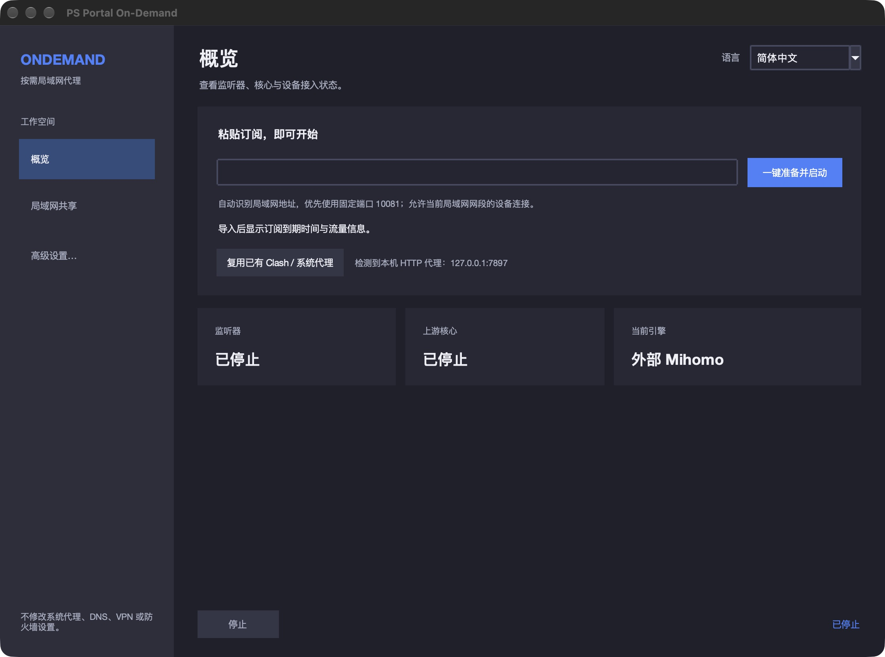

# 星渡 StarPass · 按需代理与设备共享

星渡 StarPass 延续 PS Portal On-Demand 项目。新界面以「游戏／混合／Clash」区分接入用途，
与规则／全局／直连分流设置分开；[各平台的实际模式范围与限制](docs/starpass-platform-modes.zh-CN.md)
说明了哪些能力已实现。桌面不自动设置系统代理，Android 本机代理仍需 VPN 授权，iOS 默认前台共享，iOS 26+ 限时后台实验仍需系统实际授权与真机验收。

让不方便安装代理客户端的设备，通过电脑、手机或路由器上的 HTTP/HTTPS 代理接入网络。外网请求按需唤醒自己管理的核心，空闲后回收；局域网请求直连。界面参考 Clash 的使用习惯，核心仍是设备共享与按需运行。

[本机开发版使用说明](START-HERE.md) · [本轮验证](VALIDATION-LOCAL.md) · [需求与进度](REBUILD.md) · [历史产物下载](docs/downloads.zh-CN.md) · [路由器指南](README.zh-CN.md)

2026-10-19：已整合设备连接统计、独立订阅的节点切换及最低延迟自动选择，并纳入 GitHub 新增的 Windows/Linux 只读网络识别与 YAML 打包审计修复。[云端检查与日志说明](GITHUB-STATUS.md)。

当前是开发预览版，未发布本轮独立安装包。仓库中的 `OnDemand Desktop Local.app` 仅供已准备运行环境的当前开发工作区使用，不能单独复制到其他电脑。历史下载产物不包含本轮界面改动。

## iStoreOS / OpenClash 联动

路由器新增显式 `openclash` 模式：复用已运行的 OpenClash 节点、订阅与规则，星渡只管理指定设备的 HTTP/TCP 入口和空闲会话，不再复制核心。独立 `standalone` 模式保留。安装、认证、fake-IP、DIRECT 与未验证边界见[完整联动指南](docs/openclash-linked.zh-CN.md)。

## Android 手机独立运行

Android v4 开发源码改为单应用内嵌 Mihomo，局域网共享、代理本机应用和后台继续运行分别可选，提供规则／全局／直连模式。本机代理默认关闭，开启须通过 Android 系统 VPN 授权；仅本机代理时不开放局域网端口。支持范围、未验证项目与签名限制见 [Android 说明](native/android/FULL-CORE.md)。下面的两种方式主要说明桌面流程。

## 两种使用方式

| 模式 | 操作 | 节点与规则由谁管理 |
| --- | --- | --- |
| 导入自己的订阅 | 粘贴一次导入订阅 → 点击“启动共享” → 按页面提示设置设备 Wi-Fi 手动 HTTP 代理 | OnDemand 管理自己的 Mihomo；完整配置保留原节点、策略组与规则 |
| 关联现有 Clash／系统代理 | 检测本机已配置的回环 HTTP 代理 → 点击复用 → 设置设备 Wi-Fi 代理 | 原 Clash 客户端管理节点、测速、规则与核心；OnDemand 只提供局域网入口 |

本程序不切换原 Clash 的节点、不修改其配置，也不停止原 Clash。打开窗口与切换语言不会启动代理服务，不修改系统代理、DNS、VPN 或防火墙。

## 桌面快速开始

Mac 已经准备好本机开发环境时，双击 `OnDemand Desktop Local.app` 或 `Launch macOS.command`。源码运行与依赖准备见 [portable/README.md](portable/README.md)，默认使用自己提供的可信 [Mihomo](https://github.com/MetaCubeX/mihomo/releases)。

Windows/Linux 使用对应平台构建的程序或源码入口；简洁流程只读取物理接口与真实掩码，接口不明确时转入高级设置，不修改系统网络。

1. 粘贴 Clash/Mihomo 的 HTTPS YAML/JSON 订阅即导入并保存，不启动服务；随后点击“启动共享”。也可以点击“复用已有 Clash／系统代理”。Windows 默认使用随包的 Mihomo，缺少时由启动流程自动准备，无需选择核心文件。联动时只开放游戏模式，混合与 Clash 模式置灰；取消联动可恢复原订阅和模式。
2. 程序识别当前局域网 IPv4，优先保留端口 **10081**，被占用时才选择备用端口。
3. 等待监听就绪，打开“局域网共享”。让设备接入同一个可互通的 Wi-Fi，在其 Wi-Fi 设置中选择 **HTTP 代理 → 手动**，填写页面显示的服务器地址、端口，认证关闭。
4. 使用结束后点击“停止”。关联模式只停止我们自己的入口和连接；独立模式回收我们自己的核心。

以界面实际显示的地址、端口为准。地址由当前网络分配，应用无法保证 DHCP 地址永远不变；网络变化后需要重新准备并更新设备代理。若要长期固定地址，可自行在路由器设置地址保留。自动接入仅支持当前私网 `/24` 至 `/30` 网段；更大范围使用高级精确 IP 名单。

## 订阅与信息显示

- 直接导入订阅时，读取服务器返回的 `subscription-userinfo`，展示已用、总量、剩余流量、到期时间及使用进度。
- 字段缺失时显示“未提供”，不把缺失统计解释为无限流量。桌面统计截至上次导入，只有显式刷新订阅才重新下载，同一链接不会重复处理。
- 标准 Clash Verge 数据目录可只读提取当前订阅名称和套餐缓存，标明“只读、非实时”与更新时间；不读取控制器来更新原订阅，不输出订阅 URL 或令牌。
- 当前接受 Clash/Mihomo YAML 与 JSON，不支持原始 Base64、单节点 URI；HTTPS 下载不跟随重定向。

右上角支持中英文即时切换；高级设置保留本地配置导入、节点策略、规则预览、日志、主题及原来的实验性 embedded 引擎。完整配置在运行副本中关闭 TUN、额外 DNS 服务监听和额外入口，原订阅文件不变。

## 节点选择与设备连接

实时控制的模式、资源上限与逐组行为见[控制说明](portable/docs/runtime-controls.md)。

普通 provider 保留原来的 `auto`（香港 → 日本 → 其他）、`prefer`（首选失败回退）、`fixed`（固定且不静默回退）。独立订阅的 Mac 外部核心模式已增加实时节点控制；完整 profile 使用原策略组。

节点页明确区分两种模式：

- **关联 Clash**：节点选择、测速与自动化全部交给 Clash，OnDemand 不接管。
- **直接订阅**：启动监听后，打开“代理策略”并点击“加载节点”。选择策略组与节点，点击“切换节点”或双击行；可单独测速，也可点击“自动选择最低延迟”。当前节点、协议、最近延迟及组策略均可见。
- **自动最低延迟**：按真实健康检查延迟选择，未测量与 0 ms 区分。桌面与旧版 Android 适配器的稳定策略要求健康节点切换超过延迟差、连续两个完整轮次并经过保持期；部分完成的测速不会推进切换轮次。核心休眠时不为周期测速重新唤醒。完整配置保留组本身的回退语义，iOS 原有即时最低延迟行为保留。延迟不是游戏服务器延迟。
- **设备连接**：首页显示按来源 IP 去重的活跃设备数与连接数；“设备连接”页列出来源 IP、当前连接数、累计接入和最近时间。连接关闭后活跃数下降，最近记录在内存中保留 5 分钟，停止服务后清空。
- **运行反馈**：首页突出“正在启动”“已启动·等待设备接入”“设备正在使用代理”，并显示实际接入地址。设备有连接不代表外网访问已成功；设备页可查看错误计数。

完整配置中的 Fallback/URLTest 保留原组的健康回退行为；请求的偏好不等于当前实际出口，不能把它描述为稳定固定路由。普通订阅的外层 Selector 则保留固定选择语义。

切换节点只影响新建连接，不强制断开现有连接。成功的手动选择和自动模式保存在本程序的私有配置中，核心空闲回收后仍保留；导入另一份配置会清除旧组偏好。普通 provider 在图形界面下增加 Selector 外层，默认仍走原地区策略；CLI 原策略保留。iOS 已同步共享状态、节点列表和设备面板；手机使用自己的内置适配器池，节点选择只在本次运行中保留，不导入完整 Clash 分组与规则。Android 已接入实时节点控制与设备连接统计，完整内联 profile 可查看真实 select 组并手动选取，受本机 VPN、连接活动及会话边界约束；它不等于桌面的全部能力。实验性 embedded 桌面显示统计不可用，避免把未知数显示为零。

## iPhone / iPad 使用

手机端仅采用订阅链接导入与自己的内置核心，无需同时运行另一款代理应用。用户要求的后台持续局域网共享尚未实现；默认切后台／锁屏会停止；新增 iOS 26+ 真机 15/30/60 分钟后台实验，必须获系统实际授权，模拟器不可用，尚未真机验收，不能按后台常驻产品验收。见 [手机需求与后台可行性](native/ios/MOBILE-REQUIREMENTS.md)。

粘贴订阅后，在“共享”页一键准备并启动；默认优先端口 10081。按页面指引给其他设备配置 Wi-Fi 手动 HTTP 代理。“节点”页点击“载入节点”后可查看名称、协议、延迟并点选切换，或启用最低延迟自动选择；“设备”页显示实际代理来源和连接。所有控制只作用于自己的内置核心，不连接其他客户端控制器。

Wi-Fi 与蜂窝上行自动识别；蜂窝不等于个人热点已开启，仍需用户确认本机热点，并检测到实际私网共享接口。网络接口、地址或掩码变化时，一键启动的监听停止并提示重新配置。iOS 无实际后台任务授权时切后台或锁屏会停止服务；限时实验不保证系统授予或完整运行时长。详情见 [iOS 说明](native/ios/README.md)。

## 平台与验证状态

| 平台 | 当前状态 |
| --- | --- |
| Windows / macOS / Linux | 同一套桌面游戏／混合／Clash 用途界面；现有代理只读复用、独立核心节点控制、设备统计与源绑定偏好保存。精确构建修复见 [PR #11](https://github.com/LONG10222/psportal-on-demand/pull/11)，旧本机数字不能代替当前提交验收 |
| Android | 内嵌完整 Mihomo 开发版：LAN、本机 VPN 与后台选项；规则／全局／直连；节点控制、设备连接统计与完整内联 profile 的 select 组控制。VPN 必须获系统授权，APK／实体设备边界另行说明 |
| iOS | 保留共享／节点／设备／设置四页及受限适配器池。默认切后台／锁屏停止；iOS 26+ 真机限时实验须实际授权。旧 SDK 的模拟器构建不包含真实后台驱动编译，不代表该实验已验收 |
| OpenWrt / iStoreOS | 单指定设备 HTTP/TCP 入口；独立核心按需启停，新增外部 OpenClash 只读联动、无核心安装与 LuCI 模式选择。见 [联动指南与验证边界](docs/openclash-linked.zh-CN.md)，未作实体路由器验收 |

平台差异与历史回归数分开记录。当前基线的本地 portable 393 项（363 通过、30 条件跳过）、
Android 348 项 JVM 断言、native 源码脚本 48 项及 iOS 源码守卫 7 通过/1 条件跳过，
属于各自已注明的基线；最新精确提交的 Actions 和限制见 [上传校验说明](docs/starpass-reconciliation-2026-10-19.zh-CN.md)。
路由器新增的模拟测试不替代真实 OpenWrt/procd/LuCI/OpenClash 或游戏设备验证。

2026-10-18 用户反馈手机已经接入并可使用；这是用户提供的实际使用反馈，不替代开发侧的独立端到端验收。真实 iPhone 个人热点、游戏机、公网加密节点及不同设备仍需逐项验证。编译、模拟器与真机验证不等价。

## 边界

本项目转发 HTTP 与 HTTPS CONNECT，**不是任意 UDP 游戏中继**，不能保证所有游戏流量都遵循设备的手动 HTTP 代理。只在可信局域网使用，不向公网转发监听端口。活跃设备统计只能反映连接到本程序的客户端，不能枚举路由器上的所有 Wi-Fi 设备。

iPhone 使用公开接口区分 Wi-Fi 与蜂窝；蜂窝连接不代表个人热点已开启。热点模式需要真实可读取的私网共享接口及用户确认。iOS 不能任意读取其他代理应用的私有配置；没有真实后台任务授权时，切换应用或锁屏会停止服务。限时实验不承诺后台常驻或完整运行时长。

## 文档与开发

- [本机验证记录与复现](VALIDATION-LOCAL.md) · [Clash 开源参考与只读范围](SOURCE-REFERENCE.md)
- [桌面源码与构建](portable/README.md) · [原生引擎](native/README.md) · [iOS](native/ios/README.md) · [Android](native/android/README.md)
- [路由器配置与排障](docs/guide.zh-CN.md) · [English router guide](docs/router-readme.en.md)
- [安全说明](SECURITY.md) · [GitHub Actions](https://github.com/LONG10222/psportal-on-demand/actions)

## 许可证

原有路由器代码与桌面包装层使用 [MIT](LICENSE)。链接 Mihomo 的原生引擎使用 [GPL-3.0-only](native/LICENSE)，依赖遵循各自许可证。Clash Verge 仅作为界面与格式参考，未复制其图标或组件。分发原生程序时需保留同版本完整对应源码、依赖和许可证；本轮未完成公共发行许可审查，详见验证记录。

## 本轮手机界面设计

iPhone/iPad 已按星渡品牌调整为共享、节点、设备、设置四页：首页突出订阅导入与启停，接入地址和 Wi-Fi 三步说明集中显示；节点支持搜索、可用筛选和延迟排序；设置结果在原页反馈。中英文、深浅色及 iPhone 13 mini 窄屏已检查。源码与验证见 [手机设计说明](native/ios/MOBILE-DESIGN.md)。后台能力保持当前实际限制。
