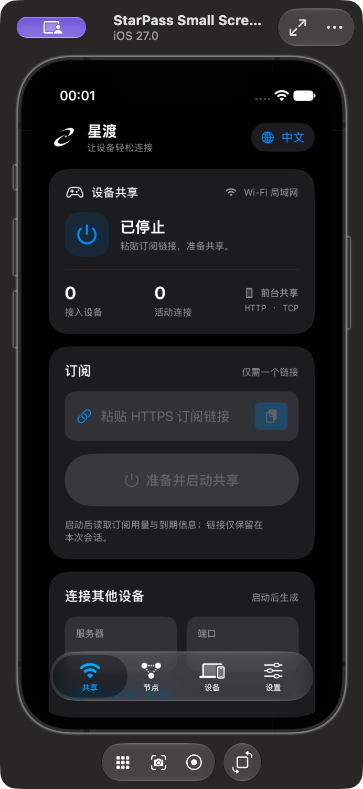
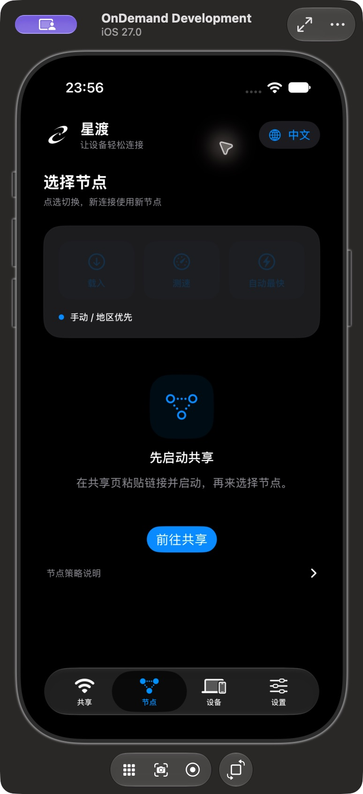
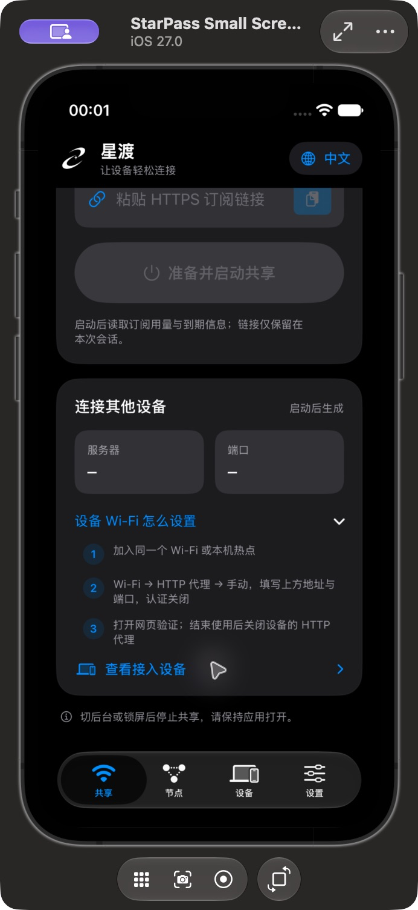

# 星渡手机 App 设计与验证

2026-10-20。本轮先检查 GitHub 更新，再在最新 StarPass 品牌基线上实现手机界面。

## GitHub 更新范围

- `main` 仍为 `5abe7274`；原手机工作分支为 `72b23e4`。
- 已整合 `feat/starpass-modes-and-brand` 的 `34369c8`，包含品牌、图标及 `3e8aab8` 的 Apple 网络／会话修复，也保留其上游 Android 与共享核心更新。没有修改其他对话的工作目录。
- `fix/windows-validation` 的 `da7ce03` 另有 Windows 工作流改进；本轮未再引入该独立支线，重点为 iOS 设计。
- 没有合并到 main；新代码仍按开发预览验证。

## 设计与操作

| 页面 | 主要操作与反馈 |
| --- | --- |
| 共享 | 真实状态与设备／连接数量；订阅输入与用户主动粘贴；单一主要启停按钮；订阅快照；服务器／端口与三步 Wi-Fi 指引 |
| 节点 | 载入、测速、自动最快；本地名称搜索、仅可用筛选和延迟排序；协议、延迟和选中态；未启动时明确引导前往共享 |
| 设备 | 活跃设备、连接与最近记录；无设备时展示下一步；诊断和隐私说明收起展示 |
| 设置 | 语言、外观、屏幕唤醒、高级接入与存储、能力及许可证；保存／校验／清理结果在当前页反馈 |

首页采用有限宽度的卡片与一致间距。长说明和高级字段移出主要流程，使用系统字体和滚动；iPhone 窄屏不压缩为密集的桌面网格。状态颜色只作辅助，文字和图标共同表达状态。

链接为空时启动禁用，输入后启用；启动中可取消，停止中禁止重复操作。旧服务器／端口不会在停止时冒充当前有效地址。PasteButton 仅在用户主动点击时请求粘贴，没有启动即读取剪贴板。

UI 不制造节点、流量或设备。节点搜索和排序只改变展示，不改订阅顺序和核心路由；切换、测速和自动选择仍由原模型及自己的核心执行。保留网络变化停止、会话失效取消；无有效后台授权时离开前台仍关闭。

## 本轮验证

- 实际 simulator-arm64 XCFramework 重建，SwiftUI 编译并链接成功。Release 产物仅面向 arm64 Simulator；泛用目标会请求缺少的 x86_64 切片，已明确限定构建架构，不宣称 Intel Simulator 支持。
- iOS 27.0 Simulator XCTest：33 项，32 通过，1 项仅限真机的数据保护检查跳过，零失败；涵盖真实桥接传输、设备遥测、会话取消及网络变化。
- 共享 Go `engine` / `mobile` 的 race 检查通过。
- iOS 源守卫 8 项通过；品牌资产检查 10 项中 9 通过，Pillow 重生成的开发者检查因未安装 Pillow 跳过。图标尺寸、来源哈希和实际 App 资源已检查。
- CUA 检查中英文热切换、深浅色、输入后按钮状态，以及设置页的校验反馈。
- 另建专用 iPhone 13 mini 模拟器，检查首屏、实际滑动和展开的 Wi-Fi 三步说明。所有截图均为停止状态；没有使用用户真实订阅启动网络。

## 上游 CI 与实际边界

所采用品牌提交 `34369c8` 的 iOS、Android、Native Desktop、基础 checks 已通过；Portable 的 Windows 仍有品牌文本编码测试失败，Unified 的 Mac 因新增品牌资源的符号链接审查失败。Linux 与 Windows Unified 通过。此为上游精确提交的快照，不代表本轮新设计的云端验证结果；新提交需独立跑 CI。

手机仅导入订阅并使用自己的核心。默认前台 HTTP/CONNECT TCP 共享；设置增加 iOS 26+ 真机限时后台实验，显示实际授权与结束时间，模拟器明确不可用；不宣称 iOS VPN、完整策略组、任意游戏 UDP 或真机热点已经可用。具体未满足需求见 [手机要求](MOBILE-REQUIREMENTS.md)。
